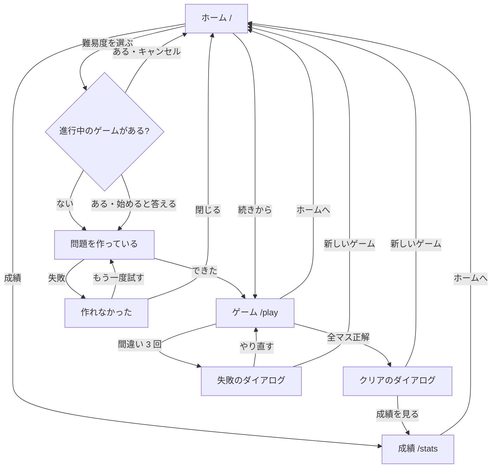

# 画面仕様書

要件は [ルートの CLAUDE.md](../../CLAUDE.md)、ゲームのルールは [src/lib/CLAUDE.md](../lib/CLAUDE.md) を参照する。

## 画面の一覧

| パス | 画面 | モック |
| --- | --- | --- |
| `/` | ホーム | [home.html](mocks/home.html)(続きあり)、[home-confirm.html](mocks/home-confirm.html)(上書きの確認)、[home-generating.html](mocks/home-generating.html)(問題を作っている)、[home-error.html](mocks/home-error.html)(作れなかった) |
| `/play` | ゲーム | [play.html](mocks/play.html)(プレイ中)、[play-paused.html](mocks/play-paused.html)(一時停止)、[play-cleared.html](mocks/play-cleared.html)(クリア)、[play-failed.html](mocks/play-failed.html)(失敗) |
| `/stats` | 成績 | [stats.html](mocks/stats.html) |

モックを `http://127.0.0.1:8000/` で配るときの手順は、技術ルールの `shadcn-tailwind.md` に従う。

## 画面遷移

## 共通

- 画面の幅は 320px 以上に対応する。横にはみ出さない。
- 文字は端末の標準のフォント(Tailwind CSS の既定)で表示する。Web フォントは読み込まない(2026-11-03 にユーザが決めた。モックと同じ見た目にし、ビルドで外への通信を要らなくするため)。
- ボタンやリンクなど、押す部分の大きさは 44px 四方以上にする。盤面のマスは例外(幅 320px では 9 マスを 44px にできない)。
- 数字のボタンは、幅 480px 未満では 5 列と 4 列の 2 段、幅 480px 以上で 768px 未満では 9 列の 1 段、幅 768px 以上では 3×3 に並べる。
- `/play` を開いたときに保存したゲームが無ければ、`/` へ移す。
- 保存できないときは、画面の上に「この端末では保存できません。ページを閉じると、ゲームと成績は残りません。」と表示する。
- 画面のボタン(難易度、続きから、操作、数字、一時停止など)は、モックに合わせて Tailwind CSS のクラスで書く。shadcn/ui の `Button` は、ダイアログのボタンだけで使う(2026-11-03 のフェーズ 6 の網羅確認で、実装に合わせて書くとユーザが決めた)。

## ホーム(`/`)

| 要素 | 文言 | 動き |
| --- | --- | --- |
| タイトル | 数独パズル | |
| 続きのボタン | 続きから(かんたん・12:34) | 進行中のゲームがあるときだけ出す。難易度と経過時間を出す。押すと `/play` |
| 見出し | 新しいゲーム | |
| 難易度のボタン | かんたん / ふつう / むずかしい | 進行中のゲームがあれば確認のダイアログ。無ければ問題を作り始める |
| 成績へのリンク | 成績 | `/stats` |

クリアや失敗で終わったゲームは「進行中」に含めない。

### 上書きの確認のダイアログ

- タイトル: 新しいゲームを始めますか?
- 本文: 進行中のゲームは消え、成績にも記録されません。
- ボタン: キャンセル / 始める
- `Esc` を押すと、「キャンセル」と同じに閉じる(2026-11-03 のフェーズ 6 の網羅確認で、実装に合わせて書いた)。

### 問題を作っている間

- 表示: 問題を作っています…(ボタンは押せない)
- 「成績」のリンクは押せる。押すと、作っている問題は捨てる(2026-11-03 のフェーズ 4 のレビューで、実装に合わせて書いた)

### 作れなかったとき

- タイトル: 問題を作れませんでした
- 本文: もう一度お試しください。
- ボタン: 閉じる / もう一度試す
- `Esc` を押すと、「閉じる」と同じに閉じる(2026-11-03 のフェーズ 6 の網羅確認で、実装に合わせて書いた)。

## ゲーム(`/play`)

### 構成

- スマホは、上から順に、情報の行、盤面、操作のボタン、数字のボタン。PC(幅 768px 以上)は、左に盤面、右に操作と数字のボタン。

| 要素 | 文言 | 動き |
| --- | --- | --- |
| ホームへのリンク | ホーム | 保存して `/` へ。タイマーは一時停止 |
| 難易度 | かんたん / ふつう / むずかしい | |
| 間違いの回数 | 間違い 1/3 | 増えたことを読み上げでも伝える |
| タイマー | 12:34 | |
| 一時停止のボタン | 一時停止 / 再開 | 押すたびに切り替える。クリアや失敗で終わったゲームでは押せない(2026-11-03 のフェーズ 6 の網羅確認で、実装に合わせて書いた) |
| 盤面 | | 下の「盤面」 |
| 操作のボタン | 元に戻す / やり直し / 消す / メモ | 「元に戻す」「やり直し」は、できないときは押せない。「メモ」は入力の状態を切り替え、オンを見て分かるようにする |
| 数字のボタン | 1〜9 | 選んでいるマスに入力する |

### 盤面

| 状態 | 表示 |
| --- | --- |
| 手がかりの数字 | 太字・濃い色 |
| 入力した正解の数字 | 青 |
| 誤りの数字 | 赤の文字、薄い赤の背景、下線(色だけに頼らない) |
| 誤りの数字と重なる数字 | 同じ行・列・ブロックで同じ数字のマスに、薄い赤の背景 |
| メモ | マスの中に 3×3 に並べた小さな灰色の数字 |
| 選んでいるマス | 濃い青の枠と背景 |
| 選んだマスと同じ行・列・ブロック | 薄い灰色の背景 |
| 選んだマスと同じ数字 | 薄い青の背景 |
| 選んだマスと同じ数字のメモ | メモの中のその数字だけを、太字・濃い青の文字にし、薄い青の丸の背景を付ける(色だけに頼らず、太さと形でも区別する。誤りの表示の N-03 と同じ考え方)。選んだマスに数字が無いとき(空欄・メモだけのとき)は強調しない。一時停止中はメモごと隠すので出ない(2026-11-04 にユーザが決めた。Issue #8) |

- 3×3 のブロックの境界は太い線にする。
- 手がかりのマス、正解の入ったマスも選べる(強調のため)。
- 最初は、どのマスも選ばない。
- 一時停止中は選んだマスを見せず、再開すると、一時停止の前に選んでいたマスが選ばれた状態に戻る。失敗のダイアログの「やり直す」の後も、選んでいたマスが選ばれたままで、フォーカスもそのマスに戻る(2026-11-03 のフェーズ 6 の網羅確認で、実装に合わせて書いた)。
- 一時停止中とゲームの終了後は、マスを選べない(矢印のキーも効かない)。一時停止中は、Tab で盤面に入らない(2026-11-03 のフェーズ 4 のレビューで書いた)。
- 各マスに、読み上げ用の名前を付ける(例: 「2 行 3 列、空欄」「2 行 3 列、5、手がかり」「2 行 3 列、5」(入力した正解)「2 行 3 列、5、誤り」「2 行 3 列、メモ 1 2 5」)。手がかりは、入力した正解と区別する(2026-11-03 にユーザが決めた)。一時停止中は「2 行 3 列」だけにする(数字とメモを読み上げない)。

### キーボード

| キー | 動き |
| --- | --- |
| 矢印 | 選ぶマスを動かす。端で止まる。マスが未選択なら左上を選ぶ |
| `1`〜`9` | 数字を入力する(メモの状態ならメモ) |
| `Backspace`、`Delete` | 消す |
| `M` | メモの状態を切り替える |
| `Ctrl` または `Cmd` + `Z` | 元に戻す |
| `Ctrl` または `Cmd` + `Shift` + `Z`、`Ctrl` + `Y` | やり直し |

一時停止中とゲームの終了後は、盤面の操作のキーを受け付けない。

### 一時停止中

- 盤面の数字とメモを隠し、中央に「一時停止中」と「再開」のボタンを出す。
- 操作のボタンと数字のボタンは押せない。

### クリアのダイアログ

- タイトル: クリア!
- 本文: かんたんをクリアしました。
- 内容: タイム 12:34 / 間違い 1 回 / ベストタイム 10:05(更新したときは「ベストタイムを更新しました!」を加える。初めてのクリア(前のベストタイムが無い)も更新として扱う(2026-11-03 のフェーズ 6 の網羅確認で、実装とモックに合わせて書いた)。この文言はクリアしたその場だけで出し、再読み込みの後は出さない。ページを開いたまま、ホームや成績へ移って戻ったときは出る(2026-11-03 のフェーズ 4 のレビューで、実装に合わせて書いた))
- ボタン: 成績を見る / 新しいゲーム
- 閉じるボタンは無い。外側を押しても、`Esc` でも閉じない。
- 再読み込みの後も、同じダイアログを出す(2026-11-03 にユーザが決めた。保存の形は変えない)。

### 失敗のダイアログ

- タイトル: 失敗しました
- 本文: 間違いが 3 回になりました。
- ボタン: 新しいゲーム / やり直す
- 閉じるボタンは無い。外側を押しても、`Esc` でも閉じない。
- 再読み込みの後も、同じダイアログを出す。

## 成績(`/stats`)

| 要素 | 文言 |
| --- | --- |
| タイトル | 成績 |
| 表の列 | 難易度 / クリア / 失敗 / クリア率 / ベストタイム |
| 表の行 | かんたん / ふつう / むずかしい |
| ホームへのリンク | ホーム |

- まだ遊んでいないときは、回数を 0、クリア率とベストタイムを `-` にする。
